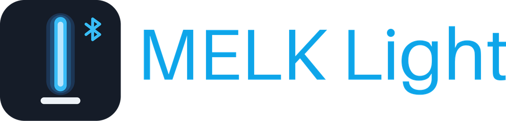
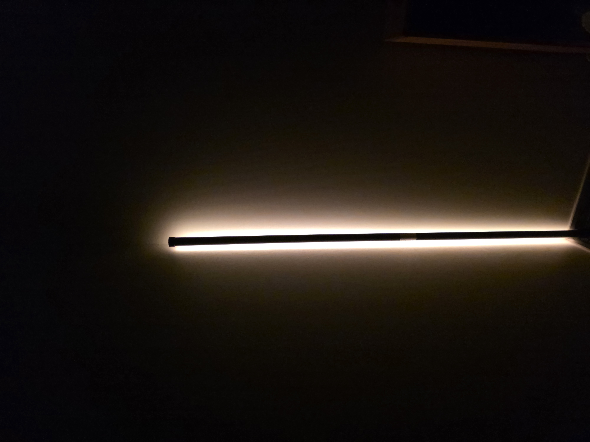
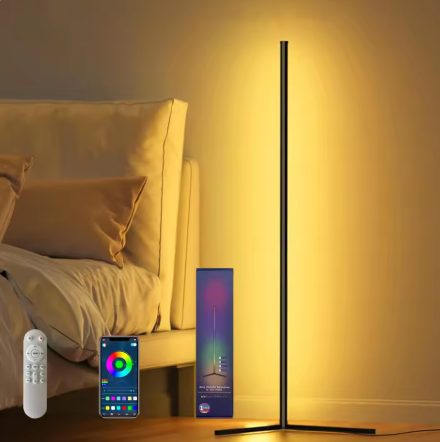

<!-- hass-standards:header:start -->
# MELK Light Bar for Home Assistant

**MELK Light Bar** (`melk_light`)용 Home Assistant 커스텀 통합입니다.

[English](README.md) | **한국어**

<!-- hass-standards:badges:start -->

<!-- hass-standards:badges:end -->
<!-- hass-standards:header:end -->

<table>
  <tr>
    <td align="center" valign="bottom">
      
    </td>
    <td align="center" valign="bottom">
      
    </td>
  </tr>
</table>

## 주요 기능

- Home Assistant Bluetooth를 통한 BLE 검색
- 조명 제어: 켜기/끄기, 밝기, RGB, 효과(모드)
- 진단 엔티티: Bluetooth 연결, 명령 소요 시간, 마지막 실패와 오류 횟수

## 요구사항

- **Home Assistant:** 2025.11.0 이상.
- **Bluetooth:** Bluetooth 어댑터 또는 ESPHome Bluetooth 프록시.
- **기기:** 지원되는 MELK Light Bar.

## 설치

<!-- hass-standards:installation:start -->

<!-- hass-standards:installation:end -->

1. 위 배지를 클릭해 마켓플레이스에서 저장소를 엽니다.
2. 저장소를 직접 추가하려면 **설정 → 마켓플레이스 → 링크에서 추가**에서 <https://github.com/eigger/hass-melk-light>을 입력합니다. 안내가 표시되면 GitHub 계정을 연결합니다.
3. **설치**를 선택합니다. 재시작 안내가 표시되면 Home Assistant를 재시작합니다. 설치가 끝나면 [설정](#설정)으로 이동합니다.

## 설정

**설정 → 기기 및 서비스 → 통합 추가 → MELK Light Bar**를 선택합니다.

## 중요 제한사항

- 안정성과 수신 범위를 위해 ESPHome Bluetooth 프록시를 권장합니다. [Bluetooth 프록시 설정](https://github.com/eigger/blesession/blob/main/docs/bluetooth.ko.md)과 [문제 해결](docs/troubleshooting.ko.md)을 참고하세요.
- 명령 전 조명 전원을 켜고 다른 제어 앱의 연결을 종료하세요. 기기는 명령 수신 확인을 보내지 않으므로, 표시 상태는 성공한 쓰기를 바탕으로 추정합니다.
- 마지막 명령 후 30초 동안 연결을 재사용합니다. 명령 실패는 오류로 표시되며 Bluetooth 경로를 확인한 뒤 다시 시도하세요.

## 구매처

- [AliExpress (150cm)](https://ko.aliexpress.com/item/1005009699069006.html)

## 개발

실제 HA 테스트 환경과 명령은 [CONTRIBUTING.md (영어)](CONTRIBUTING.md)을 참고하세요.

<!-- hass-standards:support:start -->
## 지원

- [Issues](https://github.com/eigger/hass-melk-light/issues): 버그를 신고하거나 기능을 요청하세요.
- [Discussions](https://github.com/eigger/hass-melk-light/discussions): 질문하고 사용 경험을 공유하세요.
<!-- hass-standards:support:end -->

<!-- hass-standards:related-projects:start -->
## 관련 프로젝트

- [blesession](https://github.com/eigger/blesession): 이 통합에서 사용하는 공용 BLE 세션과 Bluetooth 프록시 안내입니다.
<!-- hass-standards:related-projects:end -->

<!-- hass-standards:license:start -->
## 라이선스

[MIT License](LICENSE) 라이선스로 배포됩니다.
<!-- hass-standards:license:end -->
